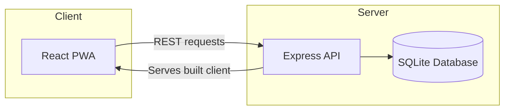

# Fitness Tracker Monorepo

Offline-first fitness tracker with a self-hosted backend. Client implemented as a progressive web application (PWA).

This repository contains two packages:

- **client/** – React progressive web application.
- **server/** – Express backend that serves the built client and provides a REST API for the app.

## Commands

Install pagackes or client and server

```sh
npm run setup
```

Run tests for both packages:

```sh
npm test
```

Build the client and server:

```sh
npm run build
```

Start the backend (after building the client):

```sh
npm start
```

## Architecture


